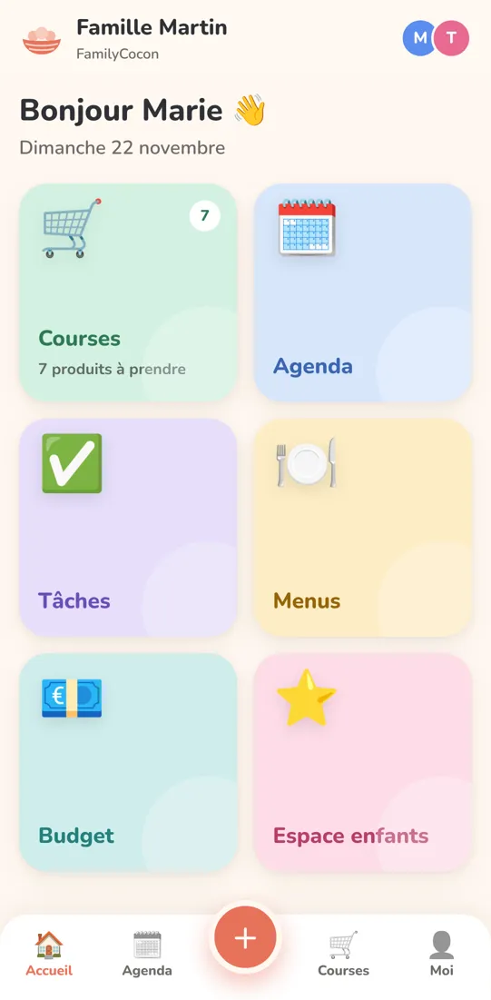
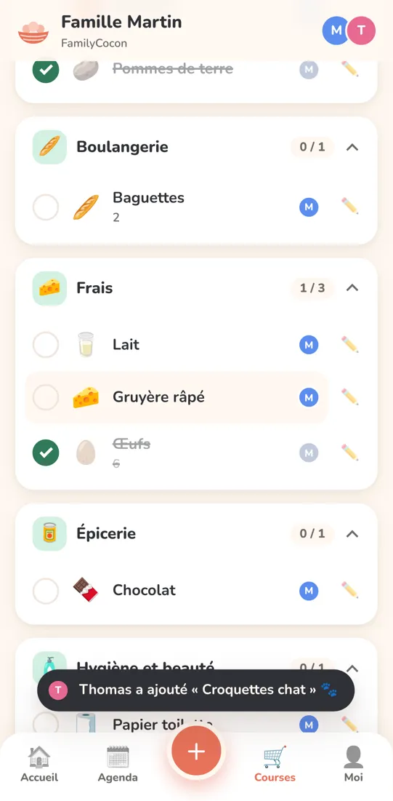
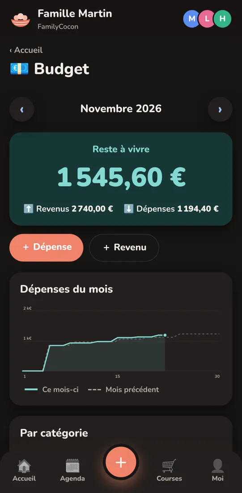

# FamilyCocon 🪺

L'organisation de la famille, **auto-hébergée** et **très légère** : courses, agenda,
tâches ménagères, menus, budget, abonnements, espace enfants, notes, contacts et
anniversaires, cartes de fidélité, véhicules, animaux, prestataires et projets,
sur le téléphone de chacun.

- Un seul binaire Go, image Docker `scratch` d'environ **16 Mo** (6,8 Mo à télécharger).
- **~8 Mo de RAM** au repos, ~20 Mo au plus fort d'un test de charge.
- amd64 et arm64 (Raspberry Pi).
- Interface en français, pensée pour le téléphone. Installable comme une appli (PWA).

| Accueil | Courses | Espace enfants | Budget (mode sombre) |
|---|---|---|---|
|  |  |  |  |

## Sommaire

- [Fonctions](#fonctions)
- [Installation](#installation)
- [Premier lancement](#premier-lancement)
- [Configuration](#configuration)
- [Mise à jour](#mise-à-jour)
- [Sauvegarde](#sauvegarde)
- [Restauration](#restauration)
- [Supervision](#supervision)
- [Mesures](#mesures)
- [Développement](#développement)

## Fonctions

- **Comptes** : un parent crée la famille et invite les autres adultes par un lien (7 jours, usage unique).
- **Rôles** : parent ou enfant. Un enfant ne supprime rien et ne voit ni le budget ni les réglages.
- **Double authentification et passkeys** (comptes à mot de passe) :
  - code d'une application (Aegis, FreeOTP, Google Authenticator…) avec codes de secours ;
  - passkeys : connexion sans mot de passe (empreinte, visage, code du téléphone), ou en second facteur ;
  - un parent peut tout réinitialiser pour un membre qui a perdu son téléphone.
- **Connexion enfant par code PIN** : sur un appareil où un parent s'est déjà connecté, l'enfant touche son prénom puis tape son code.
- **Courses** :
  - listes partagées en temps réel, produits rangés par rayon, avec un emoji ;
  - « 2 baguettes » et « 1 kg de pommes » sont compris tout seuls ; un produit ajouté deux fois ne fait qu'une ligne ;
  - le rayon choisi pour un produit est retenu ; « Souvent achetés » : un toucher pour les remettre ;
  - « Annuler » après une suppression ; la dernière liste reste lisible sans réseau (au magasin).
- **Agenda** : vue semaine et vue mois, couleur par personne ; répétitions : chaque jour, certains jours,
  chaque semaine, toutes les 2 semaines, chaque mois (même date ou « le 2e mardi »), tous les 2 mois,
  trimestriel, semestriel, chaque année, avec date de fin ;
  les tâches ménagères du jour y apparaissent en petit (toutes, les miennes, ou masquées) ;
  un événement peut citer des contacts (rendez-vous chez le dentiste, goûter chez Léo) ;
  « Me le rappeler », « Annuler cette fois seulement », échéances des autres modules en petit ;
  lien secret pour voir l'agenda dans le calendrier du téléphone (iCalendar, lecture seule).
- **Tâches ménagères** : à qui (ou à tour de rôle), quand (une fois, chaque jour, certains jours, chaque semaine,
  toutes les 2 semaines, chaque mois), qui a fait quoi ; cochées depuis l'accueil.
- **Menus de la semaine** : midi et soir ; les ingrédients d'une recette connue reviennent tout seuls ; un clic
  envoie les ingrédients aux courses (sauf ceux déjà à la maison) ; « Reprendre la semaine dernière » ; page Recettes.
- **Budget** (parents) :
  - compte commun et budget perso de chaque parent (privé), virements de l'un à l'autre (une fois ou chaque mois) ;
  - « reste à vivre » du mois et courbe des dépenses ;
  - catégories et filtres ;
  - opérations qui reviennent (chaque semaine, mois, 2 mois, trimestre, semestre ou année), ajoutées toutes seules ;
  - « à venir ce mois-ci » et reste prévu en fin de mois ;
  - plafonds par catégorie (alerte à 90 %), « Payé par » (écart entre parents), recherche sur 12 mois, vue de l'année.
- **Abonnements** (privés au choix) (parents) : box, téléphone, musique, assurance… prélevés tout seuls dans le budget ;
  coût par mois et par an, fin d'engagement, rappel avant un renouvellement annuel.
- **Espace enfants** :
  - missions à étoiles (1 à 5) ; l'enfant coche, un parent valide ou refuse ;
  - mission pour plusieurs enfants d'un coup, « Valider les N missions », étoiles bonus (ou retirées) avec un motif ;
  - récompenses échangées contre des étoiles ;
  - progrès par semaine.
- **Notes** : partagées avec la famille ou privées, couleurs, épinglées, recherche, listes à cocher (ajout rapide d'un élément, retrait des éléments cochés), photos.
- **Contacts** : le carnet central de la famille :
  - mobile, fixe, travail, e-mail, adresse, société, métier, site ; favoris en haut, groupes libres (« Foot de Léo ») ;
  - recherche par nom, numéro ou métier ; appel direct depuis la liste ;
  - import et export vCard (.vcf) pour récupérer les contacts du téléphone (parents) ;
  - « Cité par » (vétérinaire de Rex, garage de la Clio…), doublons signalés et fusion de deux fiches.
- **Anniversaires et Adresses** : deux vues du carnet (les dates à venir avec l'âge et les idées de cadeaux ; les adresses avec le plan).
- **Cartes de fidélité** : le code-barres (EAN-13, UPC-A, EAN-8, Code 128) ou le QR code est redessiné à l'écran, à montrer en caisse ;
  le type de code est détecté tout seul, et la carte se scanne avec le téléphone (caméra sur Android, photo sur iPhone).
- **Véhicules (parents), Animaux, Prestataires** :
  - échéances qui reviennent (contrôle technique, assurance, vaccin, vermifuge, ramonage…) ;
  - « C'est fait » : la ligne va dans le carnet (date, coût, kilométrage) et l'échéance est reportée ;
  - prestataires : les contacts « pro » du carnet (plombier, nounou, médecin…), avec leurs interventions ;
  - vétérinaire d'un animal, garage et assurance d'un véhicule choisis dans le carnet (appel direct) ;
  - échéance modifiable ou reportée d'un mois ; dépense du carnet ajoutée aussi au budget ;
  - véhicule : onglets « Entretien » et « Pleins » ; pour les pleins, consommation, prix du litre, coût pour 100 km et 4 graphiques (consommation, prix du litre, dépenses par mois, kilomètres par mois), sur 12 mois ou depuis le début ;
  - photo du ticket ou de la facture sur une ligne du carnet (parents) ;
  - véhicule : reprise d'une sauvegarde Fuelio (pleins, dépenses et leurs photos) ;
  - plein : scan du ticket avec le téléphone (date, litres, prix remplis tout seuls ; lecture dans le téléphone, rien n'est envoyé ailleurs).
- **Garanties** : appareils achetés, fin de garantie rappelée, où est rangée la facture, réparations.
- **Projets** (privés au choix) : étapes à cocher (avec une date et qui s'en occupe), date d'objectif, budget et dépenses.
- **Rappels** : bloc « À venir » sur l'accueil (30 jours) et notification chaque matin à 9 h
  (anniversaires, échéances, étapes de projet : aujourd'hui et dans 7 jours).
- **Personnalisation** :
  - modules activables ou désactivables par un parent ;
  - barre du bas personnalisable par chacun ; avatar (un emoji) à la place de l'initiale ;
  - fuseau horaire et monnaie réglables dans l'interface.
- **Notifications** : petites notifications en bas de l'écran en temps réel, et notifications Web Push sur le téléphone,
  seulement pour les personnes concernées (participants, enfant de la mission, parents pour une validation…).
- **Recherche** dans toute l'application (loupe de l'en-tête), sans se soucier des accents.
- **Partager vers FamilyCocon** depuis une autre appli (Android) : aux courses, en note, à l'agenda.
- **Thème** clair, sombre ou comme le téléphone ; **export** de toutes les données de la famille (JSON, sans secret) ;
  carte « Serveur » (dernière sauvegarde, taille de la base) sur un serveur d'une seule famille.

## Installation

Prérequis : Docker avec Docker Compose, et un nom de domaine en HTTPS (reverse proxy).

1. Créer un dossier et y récupérer les fichiers :

   ```bash
   mkdir -p /opt/familycocon && cd /opt/familycocon
   ```

   ```bash
   curl -fsSLO https://raw.githubusercontent.com/prohand/familycocon/main/docker-compose.yml
   ```

   ```bash
   curl -fsSL -o .env https://raw.githubusercontent.com/prohand/familycocon/main/.env.exemple
   ```

2. Régler `.env`. Au minimum `FC_URL_PUBLIQUE` (votre adresse en `https://`) et `FC_PROXYS`. Voir [Configuration](#configuration).

3. Démarrer :

   ```bash
   docker compose up -d
   ```

4. Brancher le reverse proxy sur `127.0.0.1:8080` :
   - **Nginx** : exemple dans [`deploy/nginx.conf`](deploy/nginx.conf). Pensez à `proxy_set_header Host $host;` et à `proxy_buffering off` pour `/direct` (le temps réel).
   - **Traefik** : exemple dans [`deploy/docker-compose.traefik.yml`](deploy/docker-compose.traefik.yml).
   - **Proxy qui demande une connexion** (Pangolin, Authelia…) : l'iPhone demande l'icône de l'écran d'accueil sans cookie. Laissez passer sans connexion le seul chemin `/apple-touch-icon*` (une image publique) ; sinon l'icône est une lettre sur fond gris.

Le conteneur tourne sans privilège : utilisateur 65532, système de fichiers en lecture seule, `cap_drop: ALL`, 128 Mo de RAM au plus. Toutes les données sont dans le volume `familycocon-donnees` (`/donnees`).

## Premier lancement

1. Ouvrez votre adresse : la page **Créer ma famille** s'affiche. Ensuite, la création de famille se ferme toute seule (`FC_INSCRIPTIONS=premiere`).
2. Dans **Ma famille** :
   - ajoutez les enfants (prénom et code PIN) ;
   - invitez les autres adultes (lien à envoyer) ;
   - choisissez les modules.
3. **Pour la tablette ou le téléphone d'un enfant** : connectez-vous une fois comme parent sur cet appareil, puis déconnectez-vous. L'enfant y trouve ensuite son prénom.
4. **Installer l'appli** :
   - Android (Chrome) : menu ⋮ › *Installer l'application* ;
   - iPhone (Safari) : *Partager* › *Sur l'écran d'accueil*.
5. **Notifications** : page **Moi** › *Activer sur cet appareil*. HTTPS obligatoire. Sur iPhone, il faut d'abord avoir installé l'appli (étape 4).
6. **Sécurité** : page **Moi** › *Double authentification et passkeys*. Les passkeys demandent un nom de domaine en HTTPS (pas une adresse IP).

## Configuration

Variables d'environnement, dans le fichier `.env` (modèle : [`.env.exemple`](.env.exemple)).

| Variable | Défaut | Rôle |
|---|---|---|
| `FC_URL_PUBLIQUE` | `http://localhost:8080` | Adresse vue par les navigateurs. En `https://`, les cookies sont `Secure` et `__Host-`. |
| `FC_PROXYS` | (vide) | Reverse proxys de confiance (IP ou réseau, séparés par des virgules). `X-Forwarded-For` n'est lu que s'il vient d'eux. Docker : `172.16.0.0/12`. |
| `FC_INSCRIPTIONS` | `premiere` | `premiere` (une seule famille), `ouverte` (plusieurs familles) ou `fermee`. |
| `FC_SAUVEGARDE_HEURE` | `03:30` | Sauvegarde automatique quotidienne (`non` pour la couper). |
| `FC_SAUVEGARDE_GARDER` | `7` | Nombre de sauvegardes automatiques gardées. |
| `FC_DUREE_SESSION_JOURS` | `90` | Sans visite pendant ce temps, la session expire (prolongée à chaque visite). |
| `FC_SESSION_MAX_JOURS` | `365` | Durée maximale d'une session, même utilisée chaque jour : il faut ensuite se reconnecter. |
| `FC_NIVEAU_LOGS` / `FC_FORMAT_LOGS` | `info` / `json` | Journal (`debug`, `info`, `warn`, `error` ; `json` ou `texte`). En `info` : démarrage, connexions, sauvegardes, accès refusés et erreurs ; chaque requête n'apparaît qu'en `debug`. |
| `FC_CONTACT_PUSH` | `mailto:admin@<domaine>` | Contact transmis aux services de notification. |
| `TZ` | `UTC` | Fuseau du serveur (heure des sauvegardes et des logs), ex. `Europe/Paris`. |
| `GOMEMLIMIT` | `48MiB` | Mémoire visée par le ramasse-miettes de Go. |

Le fuseau horaire de l'agenda et la monnaie se règlent dans l'interface (**Ma famille** › *Réglages*).

## Mise à jour

```bash
docker compose pull
```

```bash
docker compose up -d
```

Au démarrage, la base est migrée toute seule. Avant toute migration, une copie est faite dans `/donnees/sauvegardes/avant-migration-…db`. Pour fixer une version, remplacez `latest` par `0.1.0` (par exemple) dans `docker-compose.yml`.

## Sauvegarde

La base SQLite est copiée **à chaud**, le serveur continue de tourner (`VACUUM INTO`). Chaque copie est vérifiée (`PRAGMA integrity_check`).

**1. Sauvegarde automatique** : chaque jour à `FC_SAUVEGARDE_HEURE`, dans le volume (`/donnees/sauvegardes/auto-….db`), avec rotation. Les photos du carnet (`/donnees/pieces`) sont copiées dans `/donnees/sauvegardes/pieces`. Une photo effacée de l'appli passe dans `/donnees/sauvegardes/pieces-effacees/<date>`, gardée autant de jours que les sauvegardes de la base.

**2. Sauvegarde vers l'hôte** (recommandée, à mettre dans cron) :

```bash
./scripts/sauvegarde.sh /srv/sauvegardes/familycocon
```

- Le script fait une copie `familycocon-AAAAMMJJ-HHMMSS.db` sur l'hôte.
- Il en garde 30 (variable `GARDER`).
- Il copie aussi les photos du carnet (tickets, factures) dans `pieces/` (seulement les nouvelles).
- Exemple de ligne cron : `15 2 * * * /opt/familycocon/scripts/sauvegarde.sh /srv/sauvegardes/familycocon`.

**À la main**, en une commande :

```bash
docker exec familycocon /familycocon -sauvegarde - > familycocon.db
```

Pensez à copier ces fichiers ailleurs (autre machine, stockage externe).

## Restauration

Dans le dossier du `docker-compose.yml` :

```bash
./scripts/restauration.sh /srv/sauvegardes/familycocon/familycocon-20261122-021500.db
```

Le script :

1. arrête le conteneur ;
2. vérifie la sauvegarde (intégrité, version pas plus récente que le binaire) ;
3. la met en place, en gardant l'ancienne base dans le volume (`familycocon.db.avant-restauration-…`) ;
4. redémarre le conteneur.

Si le fichier est refusé (abîmé, version trop récente), l'ancienne base reste en
place et le service est relancé. Le binaire refuse aussi de restaurer tant
qu'un serveur tourne sur le même dossier de données (verrou
`familycocon.verrou`). Lancez le script en root (ou avec `sudo`) : la copie
temporaire n'est alors lisible que par le conteneur.

Pour restaurer une sauvegarde automatique du volume, copiez-la d'abord sur l'hôte :

```bash
docker cp familycocon:/donnees/sauvegardes/auto-20261122-033000.db .
```

## Supervision

**Santé** : `GET /health` répond en JSON (200 si la base répond, 503 sinon).
Depuis la machine ou le réseau local (Docker, Uptime Kuma, Zabbix) :

```json
{"etat":"ok","version":"0.1.0","schema":8,"depuis_s":3600}
```

Depuis Internet, seul `{"etat":"ok"}` est donné (pas de numéro de version aux inconnus).

**Docker** : le `HEALTHCHECK` appelle `familycocon -sante` (l'image n'a ni curl ni wget).

**Logs** : en JSON sur la sortie standard (`docker logs familycocon`). Les échecs de connexion sont écrits avec l'IP. Exemple de filtre fail2ban :

```ini
[Definition]
failregex = "msg":"(échec de connexion|mauvais code PIN|connexion refusée : trop d'essais)".*"ip":"<HOST>"
```

**Protections intégrées** :
- limite de tentatives par IP et par compte, avec verrou progressif (15 min, puis le double) ;
- protection CSRF (origine des requêtes, plus un jeton par session) ;
- CSP stricte ;
- mots de passe et codes PIN hachés en Argon2id.

## Mesures

Mesuré le 22/11/2026 (v0.2.0), image amd64, compose fourni (`cpus: 0.5`, `mem_limit: 128m`).

| Mesure | Valeur |
|---|---|
| Binaire | 15,7 Mo (amd64), 14,7 Mo (arm64) |
| Image | ~16 Mo installée, 6,8 Mo à télécharger |
| RAM au démarrage | 8,3 Mio |
| RAM au repos (après usage) | 7,3 Mio |
| RAM en charge (30 pages temps réel + 20 clients) | 19,4 Mio au plus |
| Débit (limité à 0,5 cœur) | ~190 pages/s, 0 erreur |

Avec les modules ajoutés ensuite (notes, contacts, fidélité, véhicules,
animaux, prestataires, projets) : binaire 16,3 Mo (amd64), RAM environ
+2 Mio (mesure hors Docker, même méthode avant/après).

## Développement

Prérequis : Go 1.27.

| Commande | Rôle |
|---|---|
| `make lancer` | serveur local sur http://localhost:8080 (données dans `./donnees`) |
| `make test` | tests, avec détection des accès concurrents |
| `make verif` | formatage, `go vet`, code SQL généré à jour |
| `make sql` | régénère l'accès à la base après un changement dans `internal/donnees/requetes/` |
| `make binaires` | binaires statiques linux amd64 et arm64 dans `dist/` |
| `make image` | image Docker locale |

```
cmd/familycocon/      point d'entrée (serveur, -sante, -sauvegarde, -restaurer)
internal/appli/       cœur : sessions, CSRF, gabarits, temps réel, push, comptes, réglages
internal/base/        SQLite (WAL), migrations embarquées, sauvegarde, restauration
internal/donnees/     requêtes SQL (requetes/*.sql) et code généré par sqlc
internal/courses/     un paquet par module : courses, agenda, taches, menus, budget, enfants
internal/repetition/  règles de répétition (tâches, missions)
internal/webpush/     Web Push (RFC 8291/8292), repris de mirador-stack
web/gabarits/         pages HTML (html/template)
web/statique/         CSS, htmx, app.js, police Nunito, icônes, manifeste, service worker
deploy/               exemples Nginx et Traefik
scripts/              sauvegarde et restauration
```

Publier une version, sans terminal : sur GitHub, *Actions* › *Release* › *Run workflow*, puis saisir la version (ex. `0.1.0`). On peut aussi pousser un tag `vX.Y.Z`. La CI refait les tests, publie l'image amd64 + arm64 sur `ghcr.io`, crée le tag et la Release avec les binaires.

Les choix techniques et le modèle de menaces sont dans [`SPEC.md`](SPEC.md), l'avancement dans [`PROGRES.md`](PROGRES.md).

## Licence

GPL-3.0-or-later ([`LICENSE`](LICENSE)). Composants tiers : [`THIRD-PARTY.md`](THIRD-PARTY.md).
